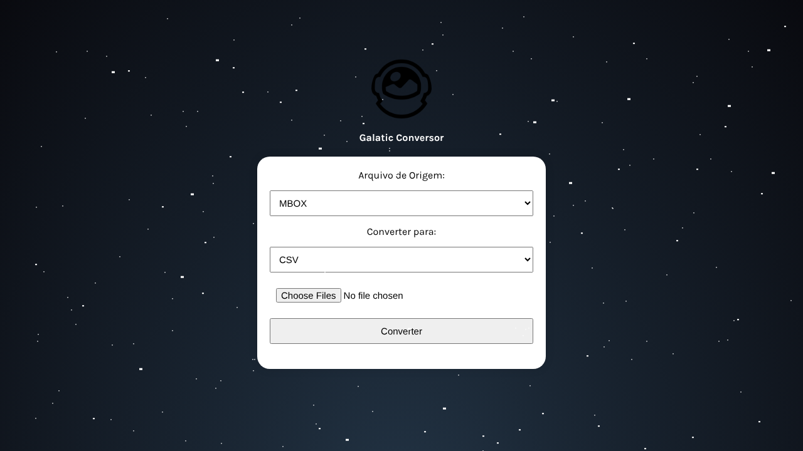

# ConversorWeb

Conversor de arquivos **ICS** (agenda/calendário) e **MBOX** (caixa de e-mail) para **CSV** ou **JSON**, direto pelo navegador.

🔗 **Testar agora:** https://conversor-pi-gilt.vercel.app



## ✨ Como funciona

1. Escolha o tipo do arquivo de origem (`MBOX` ou `ICS`).
2. Escolha o formato de saída (`CSV` ou `JSON`).
3. Selecione o arquivo e clique em **Converter**: o arquivo convertido é baixado na hora.

Útil para exportar e-mails ou eventos de agenda para planilhas, análises ou outros sistemas.

## 🛠️ Tecnologias

- **Front-end (este repositório):** HTML, CSS, Bootstrap 5 e JavaScript (`fetch` para enviar os arquivos), hospedado na Vercel
- **Back-end:** [ConversorAPI](https://github.com/offryan/ConversorAPI), em Python com FastAPI, hospedada no Render

```
Navegador ──(arquivo + origem + destino)──▶ ConversorAPI /convert ──▶ arquivo convertido
```

## ▶️ Rodando localmente

```bash
git clone https://github.com/offryan/ConversorWeb.git
cd ConversorWeb
python -m http.server 8000
```

Acesse `http://localhost:8000`. Por padrão o front usa a API publicada; para usar uma API local, troque a URL em `script/script.js`.

## 📄 Licença

© 2025-2026 Ryan G. Santos. Todos os direitos reservados. O código está público apenas para portfólio e avaliação: não é permitido copiar, modificar, distribuir ou usar comercialmente sem autorização por escrito. Veja o arquivo [LICENSE](LICENSE).
